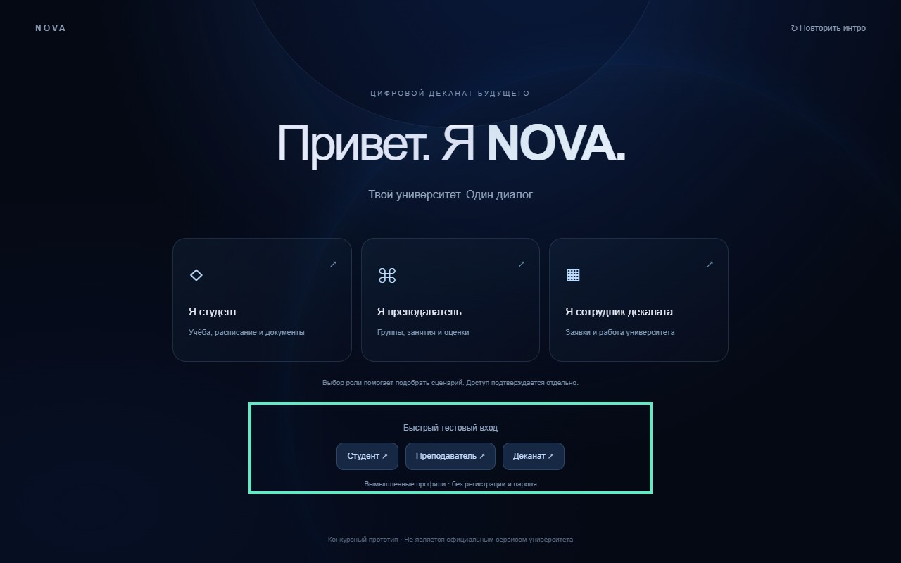

# NOVA — цифровой деканат

**Учебный проект для хакатона MGIMO AI Challenge**

Узнать, где следующая пара, заказать справку или написать преподавателю можно прямо в NOVA. Студент отправляет вопрос из чата, деканат видит обращение в своём кабинете, а ответ возвращается студенту. У каждой роли своё рабочее место, и все работают с одной учебной базой.

**[Открыть демо](https://prosto19.github.io/Nova/)** · **[Посмотреть PDF с примерами и скриншотами](docs/NOVA-guide.pdf)**

Демо открывается в браузере. Выберите тестовую роль и попробуйте сервис на вымышленных данных. Изменения сохраняются в вашем профиле браузера.

## Техническая справка

| Инструмент | Задача в проекте |
| --- | --- |
| HTML, CSS и JavaScript | Интерфейс трёх кабинетов, чат, календарь, формы, анимации и голосовая экскурсия. |
| Node.js | Серверная обработка запросов, проверка доступа и выполнение учебных действий. |
| SQLite | Хранение пользователей, расписания, оценок, заявлений, переписки и истории изменений. |
| Ollama и Qwen2.5 | Свободный диалог с языковой моделью в серверной версии при подключённой Ollama. |
| Silero TTS и PyTorch | Подготовка русской озвучки экскурсии голосом Альбины. Готовые аудиофайлы воспроизводятся в браузере. |
| GitHub Pages и sql.js | Публикация онлайн-демо и работа с учебной базой SQLite прямо в браузере через WebAssembly. |

### Как взаимодействуют компоненты

Интерфейс передаёт запросы обработчикам приложения. Они проверяют роль пользователя, читают учебные данные и возвращают ответ в чат или соответствующий раздел. Изменения проходят через предусмотренные сценарии. Например, заявка студента появляется у деканата, решение сохраняется в её истории, а студент видит новый статус.

Ассистент использует два механизма. Встроенные сценарии помогают получить расписание, оформить заявку или подготовить сообщение. Подключённая через Ollama модель Qwen2.5 отвечает на свободные вопросы с учётом доступного ей контекста. Отправку сообщений и значимые изменения пользователь подтверждает в интерфейсе.

### Как работает опубликованное демо

GitHub Pages загружает интерфейс и вымышленную учебную базу. Библиотека sql.js обрабатывает данные в браузере, а изменения сохраняются в localStorage. При переключении ролей в одном профиле браузера можно проверить полный путь заявки или сообщения. У каждого посетителя собственная копия базы.

В онлайн-демо учебные действия работают сразу. Если для вопроса нет встроенного ответа, NOVA предлагает кнопку «Спросить модель». После её нажатия браузер скачивает Qwen2.5 с Hugging Face при первом запросе и генерирует ответы на устройстве. Скорость зависит от соединения и процессора. В серверной версии свободный диалог обслуживает Ollama.
